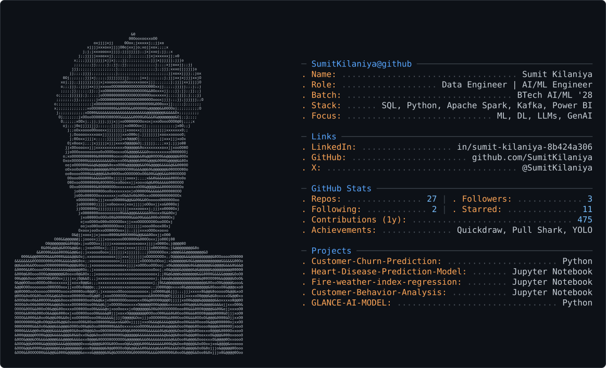

💫 Hi 👋, I'm Sumit Kilaniya
**A Data Analyst || Data Engineer|| Data Scientist || AI Engineer**

  

<!--  
💫 Hi 👋, I'm Sumit Kilaniya
**A Data Analyst || Data Engineer || AI Engineer**
# 💫 About Me:
😳i'm currently working on Google

## 🌐 Socials:
 

# 💻 Tech Stack:
         
# 📊 GitHub Stats:
 
 

<!-- Proudly created with GPRM ( https://gprm.itsvg.in ) -->

<!--# 💻 Tech Stack:
         

 

   

 

 Proudly created with GPRM ( https://gprm.itsvg.in )  

<picture>
<source media="(prefers-color-scheme: dark)" srcset="https://raw.githubusercontent.com/SumitKilaniya/SumitKilaniya/main/dark.svg">
<source media="(prefers-color-scheme: light)" srcset="https://raw.githubusercontent.com/SumitKilaniya/SumitKilaniya/main/light.svg">

</picture>

 -->

<!--## 🌐 Socials:
 -->

# 💻 Tech Stack:
         
# 📊 GitHub Stats:

 
 

<!-- Proudly created with GPRM ( https://gprm.itsvg.in ) -->

